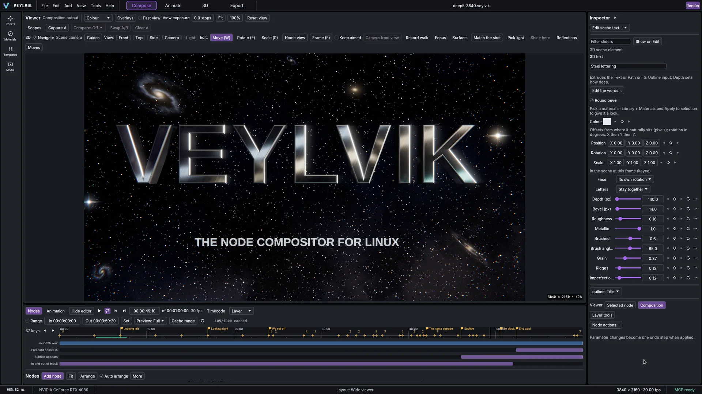
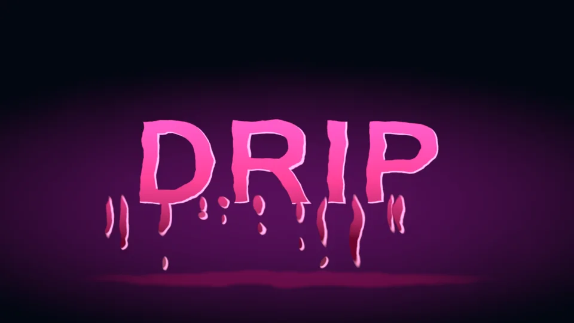
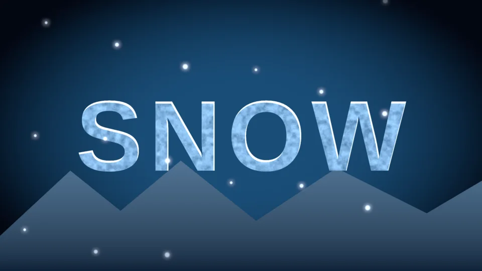
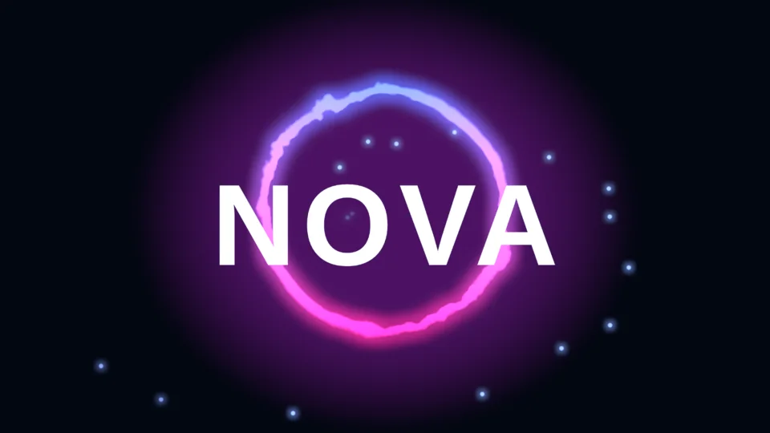
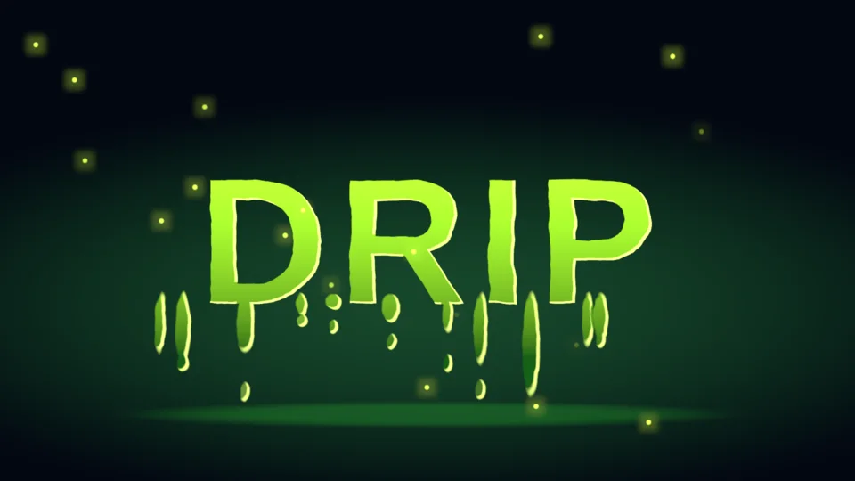
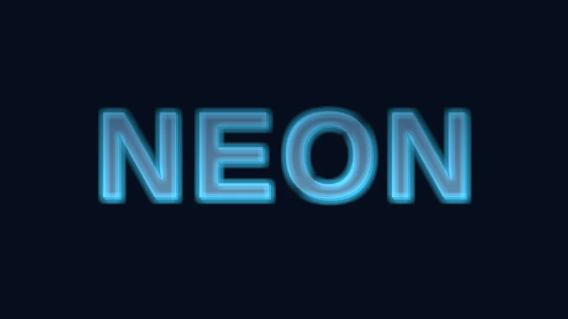
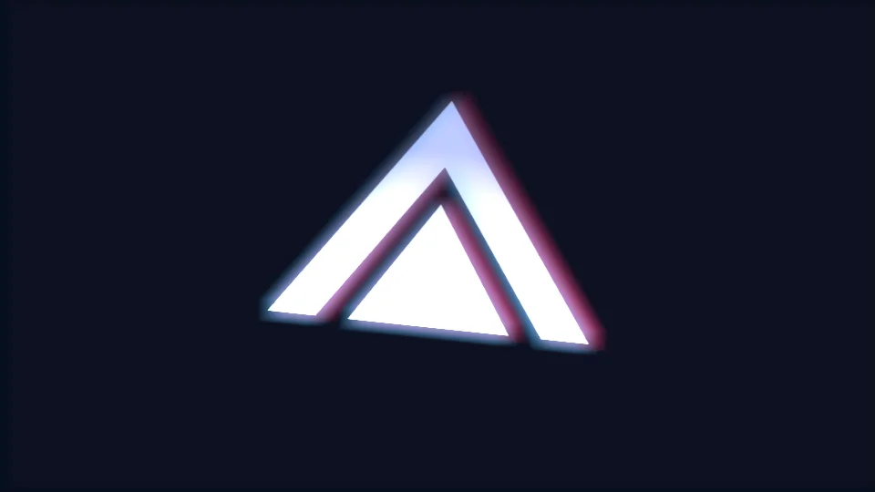

<h1>
  <picture>
    <source media="(prefers-color-scheme: dark)" srcset="assets/branding/veylvik-logo.svg">
    
  </picture>
</h1>

**A native node compositor for Linux.**

[Reference](docs/reference.md) · [Build from source](#try-veylvik) · [MCP](#automation-and-assistants)

Build shots from nodes, animate every value with keyframes and curves, mask and grade in scene-linear HDR, and render on the GPU through Vulkan. Drive it from the editor, the command line, or an MCP-compatible assistant.

**Early development · Vulkan GPU required · Arch package or source · GPL-3.0-only**

Veylvik is young, but it already works end to end: compose a graph, animate it, preview it live on the GPU, and export HDR frames and sequences. Keep copies of work you care about, because the project format can still change. No release has been published yet; build it from source or as a local Arch package.

[](assets/readme/studio.webp)

<table>
  <tr>
    <td></td>
    <td></td>
    <td></td>
  </tr>
  <tr>
    <td></td>
    <td></td>
    <td></td>
  </tr>
</table>

*Every frame above is a bundled example scene rendered by Veylvik, including Gilded inferno in the editor. Each one opens as an editable graph, with no external fonts or media.*

## Compose, animate, deliver

- **Node graph:** connect generators, effects, masks and merges by dragging between sockets. Search and add nodes with <kbd>Tab</kbd>, find existing ones with <kbd>Ctrl</kbd>+<kbd>F</kbd>, box-select, copy and paste across projects, duplicate whole branches, and let auto-arrange keep the graph readable. Preview any node without changing the output.
- **Animation:** every scalar can be keyed at exact rational times with linear, hold, ease, auto-smooth or Bézier interpolation. A curve workspace lets you edit keys and tangents directly, and keyframe markers on the timeline navigate the selected node.
- **Masks:** draw vector masks with a pen tool straight in the viewer, edit points and topology, transform the whole shape, and animate it frame by frame. Grow, shrink, feather, combine and convert channels into mattes. Guided occlusion lets you place a title behind foreground objects without wiring anything.
- **Subject masks:** click a person or object in the viewer and get a clean matte tracked through the shot by a local AI model (EdgeTAM or SAM 2.1), with a zoomed detail pass for feet and hands, ViTMatte matting for hair, and edge decontamination. One click replaces the background, keeps the subject, or puts a title behind it. Models install from an AI models manager and run on your own GPU; nothing is uploaded.
- **Tracking and keying:** GPU planar tracking that pins layers to surfaces through occlusions, camera moves and both directions, point tracking, and colour-difference chroma and luma keyers with despill and an eyedropper.
- **Text and titles:** GPU-rendered editable text with a searchable library of system and personal fonts, layout, styling and animation tools, and outlines, glows and surface materials connected as ordinary effects.
- **Looks and materials:** 59 starter effects in a searchable library. They include glows, streaks, distortions, echoes and particle overlays; procedural metals, wood, marble, brick, paper and leather; glass and reflections; procedural fire; and smoke, fog and clouds. Every starter is an editable group with public controls, and they scale to any resolution, up to native UHD.
- **Effect groups and presets:** collapse nodes into reusable effects with named controls and inputs, save them to your library, and share them as portable `.veyfx` files.
- **Colour:** processing in scene-linear Rec.709 with premultiplied alpha and no clamping, so HDR highlights and negative values survive the whole graph. HDR video in PQ or HLG (iPhone HDR) imports directly, and camera log footage (Apple Log, Sony S-Log3, ARRI LogC3/LogC4, Panasonic V-Log) decodes to scene light with its camera gamut. Camera and creative `.cube` LUTs apply in scene-linear light with their input and output spaces declared, and an ACES-style filmic display transform rolls HDR highlights off smoothly in the viewer, PNG and video. The viewer has exposure and alpha views, and a colour picker that never rewrites your HDR values.
- **Deliver:** export the current frame or a whole range as SDR PNG or lossless 32-bit float OpenEXR, or encode an MP4 on the GPU (NVENC) with the footage's sound and optional music mixed in. Sequence export writes a manifest that only marks itself complete once every frame is on disk.
- **Work safely:** atomic saves that check for changes on disk before replacing a file, bounded undo history, crash recovery copies, missing-media repair, and **Collect project** to gather a project and its images into one portable folder.

The [feature list](docs/features.md) covers everything Veylvik can do, area by area, and the [reference](docs/reference.md) documents every node, limit and command in detail.

## How it is built and tested

Veylvik is written in Rust as an eleven-crate workspace, with `unsafe` code forbidden throughout. Rendering compiles the graph into an immutable plan of compute passes and runs it on the GPU through wgpu and Vulkan. The editor is a native egui app that shows those frames from the same Vulkan device, with no copy back to the CPU.

| Crate | Role |
| --- | --- |
| `veylvik-document` | Project format, exact time, curves, node registry, atomic edits and undo. No GPU. |
| `veylvik-render` | Plan compiler, WGSL kernels, vector coverage, frame cache and preview scheduling. |
| `veylvik-text` | Font shaping, layout and editable outlines. |
| `veylvik-track` | GPU point and planar tracking, built on the renderer's narrow compute interface. |
| `veylvik-segment` | Subject mattes from local AI models, run in an isolated worker process, with a verified model installer. |
| `veylvik-decode` | Hardware-first video decoding into GPU frames. |
| `veylvik-interop` | Zero-copy hand-off of decoded and encoded video between CUDA, VA-API and Vulkan. |
| `veylvik-io` | PNG and OpenEXR in and out, sequences, presets, recovery and collection. |
| `veylvik-control` | MCP framing and the private local socket for live control. |
| `veylvik-cli` | The `veylvik` command and MCP server. |
| `veylvik-studio` | The native editor. |

- **Hundreds of automated tests** cover the document model, animation, presets, text, the editor's logic and the renderer.
- **Vulkan tests** render real frames on a software or hardware adapter and check the pixels. They are kept separate, so document and control tests also run on machines without graphics.
- **Everything is bounded:** image sizes, GPU memory, undo history, preset files and protocol messages each have explicit limits that are validated before any work starts. There is no silent CPU fallback; if Vulkan is unavailable, Veylvik says so.

## Try Veylvik

The primary target is **x86_64 Arch Linux and Arch-based distributions, such as Omarchy, with a working Vulkan driver**. aarch64 builds are supported by the package recipe. The editor runs on Wayland and X11; the command line needs no display.

Build and install a local Arch package from a checkout:

```bash
sudo pacman -S --needed base-devel git desktop-file-utils
git clone https://github.com/davidkodar/veylvik.git
cd veylvik
./bin/package
sudo pacman -U target/packages/veylvik-0.1.0-1-x86_64.pkg.tar.zst
```

This installs `veylvik` and `veylvik-studio`, a launcher entry, and **Open with Veylvik** for `.veylvik` projects. Or build and run straight from the source tree:

```bash
cargo build --workspace --release --locked
./target/release/veylvik open                                   # editor with a demo scene
./target/release/veylvik demo /tmp/energy.veylvik --procedural  # write an example project
./target/release/veylvik render /tmp/energy.veylvik /tmp/frame.exr 24 24
```

The toolchain is pinned to Rust 1.98.1 in `rust-toolchain.toml`. File dialogs use the desktop portal. See [Build and run](docs/reference.md#build-and-run) for every command.

## Automation and assistants

`veylvik mcp` exposes a project to any MCP-compatible assistant. It can inspect the graph, read the node catalogue with its schemas, apply atomic batches of edits with dry runs, insert presets, undo, and render frames or sequences. Every change is guarded by the document revision, and a batch becomes a single undo step.

`veylvik mcp --studio` drives the open editor live through a private local socket that Studio opens in your runtime directory. Register it once with your MCP client and it finds the editor whenever it is running. Remote edits appear in the editor and share its undo history. Start Studio with `--no-control` to turn live control off, and keep in mind that the assistant you connect may use a local or cloud model depending on your MCP client.

Read the [MCP reference](docs/reference.md#mcp) for the tools and command schema.

## Roadmap

- **Klipp integration:** use Veylvik compositions and effect presets inside [Klipp](https://github.com/davidkodar/klipp), the native video editor for Linux, using the project's size, frame rate and footage.
- **Colour:** an ACEScg (AP1) working gamut alongside Rec.709.
- **Tracking:** smoothing and a forward-backward quality measure for planar tracks.
- More generators, a general particle emitter, and nested groups.

## Documentation and development

- [Features](docs/features.md)
- [Reference](docs/reference.md)
- [Native editor](docs/reference.md#native-editor)
- [Composition and rendering](docs/reference.md#composition-and-rendering)
- [Development checks](docs/reference.md#development)

Run these before sending a change:

```bash
cargo fmt --all --check
cargo clippy --workspace --all-targets --locked -- -D warnings
cargo test --workspace --locked
cargo test --workspace --locked -- --ignored --nocapture --test-threads=1   # Vulkan
```

There is no hosted CI; the checks run locally, and the Vulkan tests need a working GPU or a software adapter. Sign off commits under your own name.

## Licence

Veylvik is licensed under [GPL-3.0-only](LICENSE).
