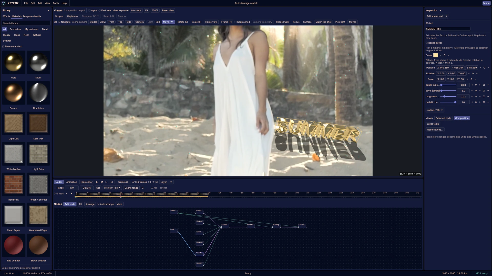
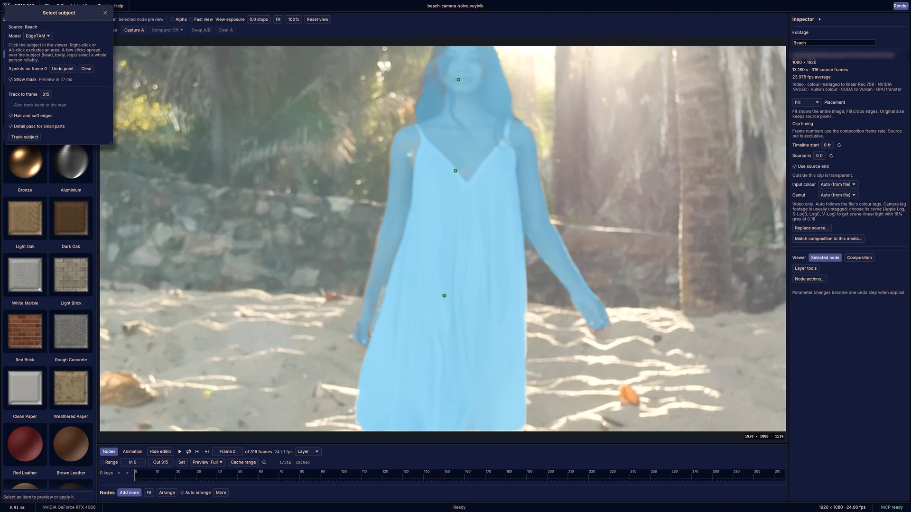
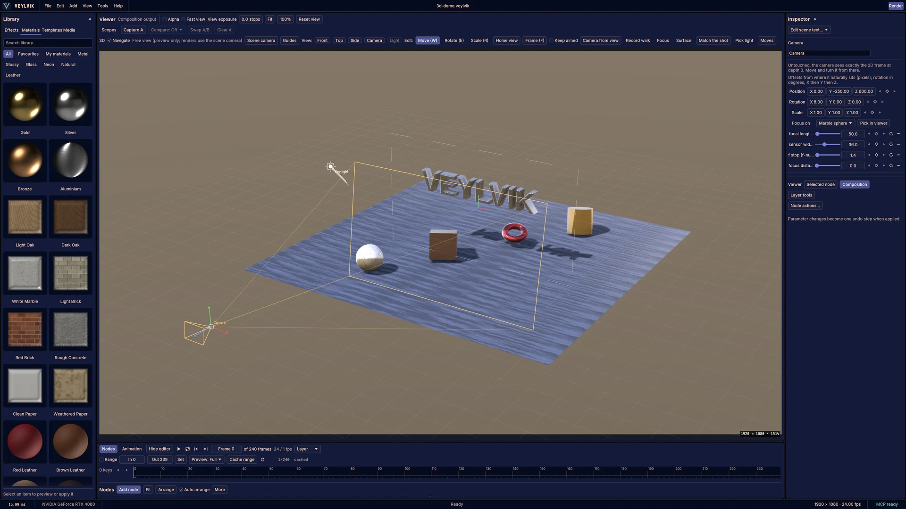

<h1>
  <picture>
    <source media="(prefers-color-scheme: dark)" srcset="assets/branding/veylvik-logo.svg">
    
  </picture>
</h1>

**A native node compositor for Linux.**

[Reference](docs/reference.md) · [Build from source](#try-veylvik) · [MCP](#automation-and-assistants)

Build shots from nodes, animate parameters with keyframes and curves, mask and grade in scene-linear HDR, and render on the GPU through Vulkan. Drive it from the editor, the command line, or an MCP-compatible assistant.

**Early development · Vulkan GPU required · Arch package or source · GPL-3.0-only**

Veylvik is young, but it already works end to end: compose a graph, animate it, preview it live on the GPU, and export HDR frames and sequences. Keep copies of work you care about, because the project format can still change. Build it from source or as a local Arch package.

[](assets/readme/3d-in-footage.webp)

<table>
  <tr>
    <td><a href="assets/readme/cut-out.webp"></a></td>
    <td><a href="assets/readme/3d-scene.webp"></a></td>
  </tr>
</table>

*Screenshots of Veylvik Studio: 3D text in a filmed shot with a solved camera, a subject selected with three clicks, and a 3D scene with its camera and light. Beach footage: ["A young woman's portrait at the beach"](https://mixkit.co/free-stock-video/a-young-womans-portrait-at-the-beach-1221/), Mixkit (Mixkit Stock Video Free License).*

## What it aims to do well

- **3D in filmed shots without a long setup.** Solve camera finds the camera of a moving shot and adds a matching camera, a ground that catches shadows and the footage's own grain, and tells you plainly how well it solved. Match the shot points a sun where the footage's light comes from. On rendered test footage the solved camera stays within 0.1° and 0.1% of the true path; real footage with heavy stabilisation or rolling shutter solves less tightly.
- **Click to cut out.** Select a person or object and get a tracked mask with hair and soft edges, computed by a local model on your own GPU.
- **A modern 3D look.** Physically based materials, HDR environments, soft shadows, depth of field and motion blur for 3D text, shapes and glTF models, with a library of ready-made materials.
- **Scriptable by assistants.** An MCP server lets an assistant build and edit comps, track, solve cameras and render, either headless or in the open editor.
- **Linux first.** A native Vulkan application, open source under GPL-3.0, with scene-linear HDR throughout and explicit errors instead of silent fallbacks.

Many of these tools are new and have been tested on a small set of shots so far. Reports from real projects are very welcome.

## Compose, animate, deliver

- **Node graph:** connect generators, effects, masks and merges by dragging between sockets. Search and add nodes with <kbd>Tab</kbd>, find existing ones with <kbd>Ctrl</kbd>+<kbd>F</kbd>, box-select, copy and paste across projects, duplicate whole branches, and let auto-arrange keep the graph readable. Preview any node without changing the output. Hide the editor to give the viewer more room while retaining playback and the time ruler. Cards have vector icons, text excerpts or material/finish summaries, category strips and labelled inputs; detail reduces as you zoom out.
- **Colour scopes:** GPU histogram, waveform, RGB parade and vectorscope with Klipp-aligned 10-bit traces, scales and graticules, individually or adaptive Four-up, measuring live B or captured A in display-referred RGB.
- **A/B viewer:** capture a GPU reference and compare it with the live result using a draggable wipe or synchronised side-by-side view.
- **Playback:** footage sound through your chosen output (PipeWire by default), inclusive In/Out ranges, GPU caching, optional lossless session disk caching and cache indicators. Full/Half/Quarter completed previews reduce retained memory; effect evaluation and exports remain at project resolution.
- **Animation:** every scalar can be keyed at exact rational times with linear, hold, ease, auto-smooth or Bézier interpolation. A curve workspace lets you edit keys and tangents directly, and keyframe markers on the timeline navigate the selected node. Frame stepping and a stable-width frame counter support precise scrubbing.
- **Masks:** draw vector masks with a pen tool straight in the viewer, edit points and topology, transform the whole shape, and animate it frame by frame. Grow, shrink, feather, combine and convert channels into mattes. Guided occlusion lets you place a title behind foreground objects without wiring anything.
- **Subject masks:** click a person or object in the viewer and get a clean matte tracked through the shot by a local AI model (EdgeTAM or SAM 2.1), with a zoomed detail pass for feet and hands, ViTMatte matting for hair, and edge decontamination. One click replaces the background, keeps the subject, or puts a title behind it. Models install from an AI models manager and run on your own GPU; nothing is uploaded.
- **Tracking and keying:** GPU planar tracking that pins layers to surfaces through occlusions, camera moves and both directions, point tracking, and colour-difference chroma and luma keyers with despill and an eyedropper.
- **Text and titles:** GPU-rendered editable text with a searchable library of system and personal fonts, layout, styling and animation tools, and outlines, glows and surface materials connected as ordinary effects.
- **Blur and defocus:** box and gaussian blur, plus a lens blur that turns lights into round bokeh discs and animates for rack focus.
- **Temporal effects:** branch-local GPU shutter motion blur with separate preview/final samples, plus source-time remapping for speed, reverse, freeze and animated ramps. Time remap preserves footage trims and transparent boundaries; it does not retime audio or interpolate missing video frames. The Shutter Motion Blur starter demonstrates exposure sampling.
- **Looks and materials:** 74 starter effects in a searchable, categorised library with animated hover previews, drag-and-drop, double-click actions and context menus. They include glows, streaks, distortions, echoes and particle overlays; procedural metals, wood, marble, brick, paper and leather; glass and reflections; procedural fire; depth-layered airborne dust; silhouette-driven wet ink and refractive water drips; a separate condensation coating with beads, fine moisture and sliding trails; and smoke, fog and clouds. Every starter is an editable group with public controls, and they scale to any resolution, up to native UHD.
- **Materials that sit in the shot:** one click makes chrome, gold or lacquer reflect the footage behind it, blurred by roughness, with the studio's highlights blended in as much as you like.
- **Shared lights:** a Light rig node lights any number of titles and logos at once; drag a light in the viewer and every surface and shadow follows, press Match the shot to take the light's direction and colour from the footage, or let a light ride on a planar track.
- **67 materials:** metals, chrome and anodised colours, liquid metal, plastics, enamel, car paint with flakes, carbon fibre, holographic foil, pearl, see-through glass, ice and gemstones that bend the shot, neon, marbles, slate, woods, fabrics, brick, leathers and papers.
- **Image textures and PBR maps:** any image, logo or footage can be a material's surface, with Normal (OpenGL or DirectX), Roughness and Height maps from libraries such as ambientCG.
- **3D scenes:** extruded 3D text, shapes, image cards, cameras, lights with soft shadows, contact occlusion, depth of field, motion blur, shadow catchers, glTF models, a camera solve from footage, lights and grain matched to the shot and HDR environments in the node graph, rendered on the GPU with studio-lit PBR surfaces or any library material, and composited like any layer. Orbit, pan, dolly or walk through a scene in the viewer (WASD and mouse look) and record a walk as camera keys.
- **Grounded titles:** contact shadows make text sit on the surface behind it, dense at the edges and leaning away from its lights, with or without a cast shadow.
- **Layered and worn materials:** put one material over another through a mask, with automatic edge wear that chips paint off corners and edges first.
- **Your own materials:** recolour any patterned surface (black marble with gold veins, navy leather), save the whole look as your own material, star favourites, and reuse them on text, backgrounds and layers.
- **Metal finishes and lighting:** choose Gold, Silver, Bronze or Aluminium, then Polished, Satin, Matte or Brushed. Roughness, grain and directional brushing remain editable, with a Custom state for manual adjustments. A filtered HDR studio supplies default reflections; environment strength/rotation, up to eight optional area lights, and the material’s optical response are editable. Tarnish and dirt are separate effects. These are GPU-shaded 2.5D surfaces, not ray-traced 3D objects.
- **Curated material recipes:** Weathered Bronze combines satin metal and patina; Brushed Light Sweep adds a moving reflection to directional aluminium; Sky-lit Gold supplies animated cloud reflections. All work on text or transparent silhouettes and expose useful controls without duplicating material families.
- **Effect groups and presets:** collapse nodes into reusable effects with named controls and inputs, save them to your library, and share them as portable `.veyfx` files.
- **Optical-flow retiming:** GPU bidirectional pyramidal motion estimation, confidence diagnostics and source-frame fallback for uncertain or occluded regions and major cuts. Choose source cadence, playback speed, animated source time and Fast/Balanced/Fine analysis. Preview analysis is reduced; output stays at composition resolution. Low texture, large motion and changing illumination can still produce artifacts; this is not learned flow, vector motion blur or audio retiming.
- **Colour:** full-float premultiplied processing, with linear Rec.709 or ACEScg compositing/grading. Materials retain their authored Rec.709 colour domain through explicit GPU conversions; the public frame and EXR contract remains linear Rec.709. OpenColorIO 2.5 configurations and LUTs run on Vulkan, with separate project preview/output transforms and an explicit OCIO node. Preview transforms never bake into export; an explicitly enabled output transform affects exported pixels, including EXR. Built-in defaults are version-pinned, custom config paths rebase on Save As, and missing or changed LUT files invalidate the processor. AgX works with a configuration that supplies it, such as Blender’s; that configuration is not bundled. HDR video in PQ or HLG (iPhone HDR) imports directly, and camera log footage (Apple Log, Sony S-Log3, ARRI LogC3/LogC4, Panasonic V-Log) decodes to scene light with its camera gamut. Camera and creative `.cube` LUTs apply in scene-linear light with their input and output spaces declared, and the legacy ACES-style filmic display transform rolls HDR highlights off smoothly in the viewer, PNG and video. The viewer has exposure and alpha views, and a colour picker that never rewrites your HDR values.
- **Portable projects:** collect media, sequences, fonts and colour conversions into a verified folder; search or locate missing sources and apply reviewed relinks in one undo step.
- **Deliver:** export the current frame or a whole range as SDR PNG or lossless 32-bit float OpenEXR, or encode an MP4 using NVIDIA NVENC or Intel/AMD VA-API, including the footage's sound and optional music. Software encoding is an explicit opt-in if hardware is unavailable. Sequence export writes a manifest that only marks itself complete once every frame is on disk. A persistent render queue holds immutable composition snapshots for stills, sequences and videos, with progress, pause, cancellation, ordering and retry while you keep editing.
- **Preferences:** audio output device and volume with the device in use shown, configurable playback restart and looping, Dark/Light/Midnight Blue/Evergreen themes or live system/Omarchy appearance, interface scale, workspace defaults, hover previews, GPU buffer budget and recovery interval. Open **Edit → Preferences** (`Ctrl+,`); settings stay independent of projects.
- **Work safely:** atomic saves that check for changes on disk before replacing a file, bounded undo history, crash recovery copies with individual or bulk discard controls, missing-media repair, and **Collect project** to gather a project and its images into one portable folder.

The [feature list](docs/features.md) covers everything Veylvik can do, area by area, and the [reference](docs/reference.md) documents every node, limit and command in detail.

## How it is built and tested

Veylvik is written in Rust as a sixteen-crate workspace. Application, document and rendering crates forbid `unsafe`; native FFmpeg and GPU-handle access is isolated in `veylvik-decode` and `veylvik-interop`, with explicit unsafe-operation and safety-comment checks. `veylvik-color` isolates the native OpenColorIO C++ interface behind a safe Rust API. Rendering compiles the graph into an immutable plan of compute passes and runs it on the GPU through wgpu and Vulkan. The editor is a native egui app that shows those frames from the same Vulkan device, without copying the preview frame back to the CPU. Document editing, font shaping and orchestration run on the CPU; composition kernels, material shading and vector coverage run on Vulkan. Export and diagnostic readbacks are separate from the live viewer path.

| Crate | Role |
| --- | --- |
| `veylvik-document` | Project format, exact time, curves, node registry, atomic edits and undo. No GPU. |
| `veylvik-render` | Immutable render plans, WGSL kernels, vector coverage, material lighting, HDR environment filtering, temporal sampling, optical flow and GPU caches. |
| `veylvik-color` | Native OCIO configuration, reference transforms and GPU shader/LUT extraction. |
| `veylvik-text` | CPU font shaping and layout, producing editable outlines for GPU coverage. |
| `veylvik-mesh` | Watertight 3D meshes from vector outlines and primitive solids (the geometry behind 3D text and shapes). |
| `veylvik-scene` | Evaluates 3D scene graphs at a frame: objects, cameras, lights, transforms and projection. |
| `veylvik-render3d` | Draws 3D scenes on the GPU for Render scene, plugged into the renderer through a hook. |
| `veylvik-track` | GPU point and planar tracking, built on the renderer's narrow compute interface. |
| `veylvik-segment` | Subject mattes from local AI models, run in an isolated worker process, with a verified model installer. |
| `veylvik-decode` | Hardware-first video decoding into GPU frames. |
| `veylvik-interop` | Native CUDA/Vulkan and VA-API/DMA-BUF interoperability boundaries for video frames. |
| `veylvik-io` | PNG and OpenEXR in and out, sequences, presets, recovery and collection. |
| `veylvik-audio` | Playback sound: the export's audio mix rendered for preview and played through the chosen output device. |
| `veylvik-control` | MCP framing and the private local socket for live control. |
| `veylvik-cli` | The `veylvik` command and MCP server. |
| `veylvik-studio` | Native egui editor, inspectors, graph presentation, playback and asynchronous preview coordination. |

Hardware video paths are probed at runtime and report fallback reasons. NVIDIA direct GPU transfer is supported; the Intel/AMD DMA-BUF path is implemented but remains experimental pending validation on those devices. Hardware decoding and rendering are separate: unsupported decode/interop paths may use a reported software or RAM-staged fallback, while composition rendering still requires Vulkan.

Material presets store the same editable node parameters exposed through the registry and MCP. Lighting is shared between composition rendering and library samples. The bundled HDR studio is filtered offline on Vulkan; runtime shaders sample its roughness levels, and preview fingerprints detect stale library assets after shading changes.

- **Hundreds of automated tests** cover the document model, animation, presets, text, the editor's logic and the renderer.
- **Vulkan tests** render real frames on a software or hardware adapter and check the pixels. They are kept separate, so document and control tests also run on machines without graphics.
- **Everything is bounded:** image sizes, GPU memory, undo history, preset files and protocol messages each have explicit limits that are validated before any work starts. There is no silent CPU fallback; if Vulkan is unavailable, Veylvik says so.

## Try Veylvik

The primary target is **x86_64 Arch Linux and Arch-based distributions, such as Omarchy, with a working Vulkan driver**. aarch64 builds are supported by the package recipe. The editor runs on Wayland and X11; the command line needs no display.

Build and install a local Arch package from a checkout:

```bash
sudo pacman -S --needed base-devel git desktop-file-utils opencolorio
git clone https://github.com/davidkodar/veylvik.git
cd veylvik
./bin/package
sudo pacman -U target/packages/veylvik-0.1.0-1-x86_64.pkg.tar.zst
```

This installs `veylvik` and `veylvik-studio`, a launcher entry, and **Open with Veylvik** for `.veylvik` projects. Or build and run straight from the source tree:

```bash
cargo build --workspace --release --locked
./target/release/veylvik open                                   # editor with a demo scene
./target/release/veylvik demo /tmp/energy.veylvik --procedural  # write an example project
./target/release/veylvik render /tmp/energy.veylvik /tmp/frame.exr 24 24
```

The toolchain is pinned to Rust 1.98.1 in `rust-toolchain.toml`. File dialogs use the desktop portal. See [Build and run](docs/reference.md#build-and-run) for every command.

## Automation and assistants

`veylvik mcp` exposes a project to any MCP-compatible assistant. It can inspect the graph, read the node catalogue with its schemas, apply atomic batches of edits with dry runs, insert presets, undo, and render frames or sequences. Every change is guarded by the document revision, and a batch becomes a single undo step.

`veylvik mcp --studio` drives the open editor live through a private local socket that Studio opens in your runtime directory. Register it once with your MCP client and it finds the editor whenever it is running. Remote edits appear in the editor and share its undo history. Start Studio with `--no-control` to turn live control off, and keep in mind that the assistant you connect may use a local or cloud model depending on your MCP client.

Read the [MCP reference](docs/reference.md#mcp) for the tools and command schema.

## Roadmap

- **Klipp integration:** use Veylvik compositions and effect presets inside [Klipp](https://github.com/davidkodar/klipp), the native video editor for Linux, using the project's size, frame rate and footage.
- **Tracking:** smoothing and a forward-backward quality measure for planar tracks.
- More generators, a general particle emitter, and nested groups.

## Documentation and development

- [Features](docs/features.md)
- [Reference](docs/reference.md)
- [Native editor](docs/reference.md#native-editor)
- [Composition and rendering](docs/reference.md#composition-and-rendering)
- [Development checks](docs/reference.md#development)

Run these before sending a change:

```bash
cargo fmt --all --check
cargo clippy --workspace --all-targets --locked -- -D warnings
cargo test --workspace --locked
cargo test --workspace --locked -- --ignored --nocapture --test-threads=1   # Vulkan
```

There is no hosted CI; the checks run locally, and the Vulkan tests need a working GPU or a software adapter. Sign off commits under your own name.

## Licence

Veylvik is licensed under [GPL-3.0-only](LICENSE).
